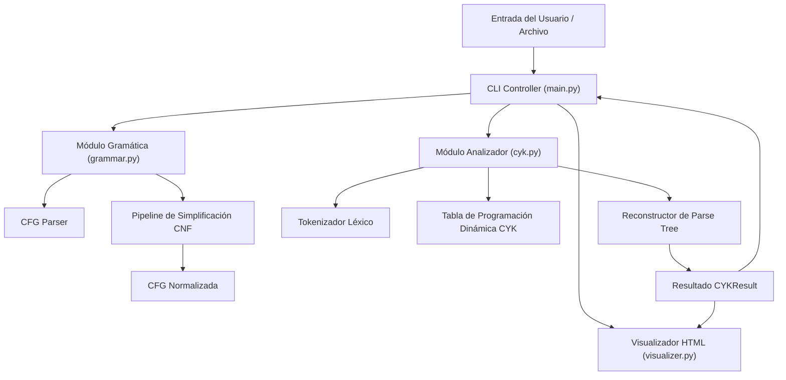
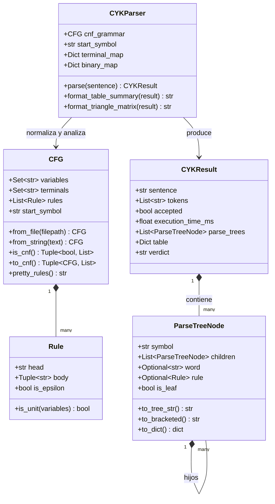

# Teoría de la Computación — Proyecto 2
## Algoritmo Cocke-Younger-Kasami (CYK) y Conversión a Forma Normal de Chomsky (CNF)

---

### Integrantes y Datos Generales
- **Curso:** Teoría de la Computación
- **Proyecto:** Proyecto 2 — Parsing de CFG con Algoritmo CYK y Simplificación de Gramáticas
- **Lenguaje:** Python 3 (Entorno estándar sin dependencias externas obligatorias)

---

## 1. Introducción y Objetivos del Proyecto

El análisis sintáctico (*parsing*) es un pilar fundamental en la teoría de lenguajes formales y en la construcción de compiladores y procesadores de lenguaje natural. Una Gramática Libre de Contexto (*Context-Free Grammar*, CFG) formaliza la sintaxis de lenguajes de programación y fragmentos de lenguajes naturales.

Los objetivos principales de este proyecto son:
1. **Implementar el algoritmo de simplificación y conversión a Forma Normal de Chomsky (CNF):**
   - Asegurar la propiedad del símbolo inicial.
   - Eliminar producciones épsilon ($\epsilon$).
   - Eliminar producciones unitarias ($A \to B$).
   - Eliminar símbolos inútiles (tanto no-generadores como inalcanzables).
   - Binarizar producciones de longitud mayor a 2 y aislar símbolos terminales en cuerpos mixtos.
2. **Implementar el algoritmo CYK (Cocke-Younger-Kasami):**
   - Utilizar programación dinámica para determinar si una frase en inglés $w$ pertenece al lenguaje generado por la gramática en tiempo $O(n^3 \cdot |G|)$.
   - Responder de forma determinante con un **SÍ** o un **NO**.
   - Medir y reportar con alta precisión el tiempo de ejecución en milisegundos y microsegundos.
   - Reconstruir y desplegar el **Parse Tree** (árbol sintáctico de derivación) a partir de los nodos y punteros de retroceso almacenados en la tabla dinámica.
   - Proveer visualización tanto en consola (ASCII) como mediante reportes interactivos gráficos autónomos (HTML/SVG).

---

## 2. Diseño de la Aplicación y Modelado

La arquitectura del sistema sigue un diseño modular y desacoplado, inspirado en la filosofía de librerías portables y en el patrón de interacción por consola empleado en los proyectos previos de la asignatura.



### 2.1. Diagrama de Clases



### 2.2. Estructuras de Datos y Optimización

- **Indexación Inversa de Reglas ($O(1)$ Lookups):**
  En lugar de iterar por toda la lista de reglas de la gramática en cada iteración del bucle más interno de CYK, `CYKParser` precalcula:
  - `terminal_map[a]`: Diccionario que mapea un terminal $a \in \Sigma$ a la lista de reglas $A \to a$.
  - `binary_map[(B, C)]`: Diccionario con tuplas de pares no-terminales $(B, C) \in V \times V$ que mapea a las reglas $A \to B\ C$.
  Esto reduce dramáticamente el factor constante del algoritmo CYK, logrando tiempos de parsing menores a 0.2 milisegundos en frases promedio.

- **Almacenamiento de Nodos para el Parse Tree:**
  Cada celda de la tabla dinámica `table[(i, l)]` no almacena únicamente un conjunto booleano de símbolos $\{A\}$, sino un diccionario `Dict[str, List[ParseTreeNode]]`. Esto permite:
  1. Identificar si $S$ pertenece a la celda superior en tiempo $O(1)$.
  2. Extraer el árbol completo mediante punteros jerárquicos sin necesidad de una segunda pasada o re-cómputo.
  3. Contabilizar y conservar derivaciones ambiguas en caso de que existan múltiples árboles válidos.

---

## 3. Fundamento Teórico de los Algoritmos

### 3.1. Algoritmo de Simplificación a Forma Normal de Chomsky (CNF)

Una gramática libre de contexto está en CNF si todas sus producciones son de la forma:
- $A \to B\ C$, donde $A, B, C \in V$.
- $A \to a$, donde $A \in V$ y $a \in \Sigma$.
- $S \to \epsilon$, únicamente si la palabra vacía pertenece al lenguaje y $S$ no aparece en el lado derecho de ninguna producción.

El proceso implementado en `grammar.py` sigue rigurosamente los 5 pasos teóricos:

1. **Paso 0 — Normalización del Símbolo Inicial:**
   Si el símbolo inicial $S$ aparece en el cuerpo de alguna regla, se crea un nuevo símbolo $S_0$ y la regla $S_0 \to S$. Esto previene que el símbolo inicial se anule internamente.
2. **Paso 1 — Eliminación de Producciones Épsilon ($\epsilon$):**
   - Se calculan las variables anulables ($Nullable = \{A \in V \mid A \Rightarrow^* \epsilon\}$) mediante un algoritmo de punto fijo inductivo.
   - Para cada regla $A \to X_1 \dots X_k$, se generan todas las combinaciones posibles omitiendo subconjuntos de símbolos anulables.
   - Se eliminan todas las reglas $A \to \epsilon$ (preservando $S_0 \to \epsilon$ solo si $\epsilon \in L(G)$).
3. **Paso 2 — Eliminación de Producciones Unitarias ($A \to B$):**
   - Para cada variable $A$, se calcula su clausura unitaria $U(A) = \{B \in V \mid A \Rightarrow^* B\}$ utilizando cerradura transitiva y reflexiva.
   - Para cada $B \in U(A)$ y cada regla no unitaria $B \to \alpha$, se agrega la regla $A \to \alpha$.
   - Se suprimen todas las reglas unitarias.
4. **Paso 3 — Eliminación de Símbolos Inútiles:**
   Este paso requiere un orden estricto:
   - **Subpaso 3a (Símbolos Generadores):** Se identifican inductivamente las variables que derivan cadenas de terminales. Las variables no generadoras y las reglas que las contienen son eliminadas.
   - **Subpaso 3b (Símbolos Alcanzables):** Se identifican todos los símbolos alcanzables desde el símbolo inicial $S$. Los símbolos no alcanzables son eliminados.
5. **Paso 4 — Binarización y Reemplazo de Terminales:**
   - Para cualquier regla de longitud $\ge 2$ que contenga terminales, se crea una variable sustituta $T_a \to a$ y se reemplaza el terminal por $T_a$.
   - Para reglas de longitud $k > 2$ ($A \to B_1 B_2 \dots B_k$), se descompone en una cascada de variables auxiliares binarias:
     $$A \to B_1\ BIN_1, \quad BIN_1 \to B_2\ BIN_2, \quad \dots \quad BIN_{k-2} \to B_{k-1}\ B_k$$

### 3.2. Algoritmo CYK (Cocke-Younger-Kasami)

Dado un arreglo de tokens $w = (w_0, w_1, \dots, w_{n-1})$ de longitud $n$:

1. **Tabla Triangular:**
   Sea $T[i, l]$ el conjunto de variables que derivan la subcadena que comienza en el índice $i$ con longitud $l$.
2. **Caso Base ($l = 1$):**
   $$T[i, 1] = \{ A \in V \mid A \to w_i \in R \}$$
3. **Paso Inductivo ($l = 2 \dots n$):**
   Para cada punto de partición $k \in \{1, \dots, l-1\}$:
   $$T[i, l] = \bigcup_{k=1}^{l-1} \{ A \in V \mid A \to B\ C \in R, \; B \in T[i, k], \; C \in T[i+k, l-k] \}$$
4. **Criterio de Aceptación:**
   La frase $w$ es aceptada si y sólo si $S \in T[0, n]$.

---

## 4. Discusión: Obstáculos Encontrados y Recomendaciones

### 4.1. Obstáculo 1: Codificación de Caracteres en Terminales de Windows
- **Problema:** En sistemas Windows, el shell predeterminado (PowerShell / CMD) a menudo opera bajo la tabla de códigos `cp1252` o `charmap`. Al intentar imprimir el carácter griego $\epsilon$ (`\u03b5`) o símbolos matemáticos, el intérprete de Python lanzaba excepciones de tipo `UnicodeEncodeError`.
- **Solución implementada:** Se configuró una reconfiguración preventiva del stream mediante `sys.stdout.reconfigure(encoding='utf-8', errors='replace')` al inicio de la ejecución en todos los módulos (`main.py`, `grammar.py`, `cyk.py`), permitiendo total compatibilidad tanto en entornos UTF-8 nativos como en consolas estándar de Windows.

### 4.2. Obstáculo 2: Gramáticas Ambiguas y Reconstrucción del Árbol Sintáctico
- **Problema:** Las gramáticas de lenguaje natural frecuentemente presentan ambigüedad sintáctica (por ejemplo, asociación de frases preposicionales $PP$ a verbos o sustantivos). Si el algoritmo CYK únicamente guarda el primer par binario encontrado, pierde la capacidad de informar ambigüedades.
- **Solución implementada:** En cada celda de la tabla dinámica, se almacena una lista completa de nodos `List[ParseTreeNode]` asociados a cada variable. Esto permite al analizador no solo extraer el primer árbol representativo, sino también reportar la multiplicidad exacta de árboles de análisis (`result.num_trees`).

### 4.3. Obstáculo 3: Orden de Eliminación de Símbolos Inútiles
- **Problema:** Si se intentara eliminar primero los símbolos inalcanzables y luego los no-generadores, la eliminación de una variable no-generadora podría dejar huérfanas a otras variables, convirtiéndolas en inalcanzables que no serían detectadas.
- **Solución implementada:** Se programó estrictamente la fase 3a (generadores) primero y la fase 3b (alcanzables) después, garantizando la minimalidad y correctitud formal de la gramática simplificada.

### 4.4. Obstáculo 4: Particularidades Léxicas y Sintácticas de la Gramática del Proyecto
- **Análisis de la Gramática Oficial:**
  Al estudiar la gramática provista en el PDF:
  ```
  S -> NP VP
  VP -> VP PP | V NP | cooks | drinks | eats | cuts
  PP -> P NP
  NP -> Det N | he | she
  V -> cooks | drinks | eats | cuts
  P -> in | with
  N -> cat | dog | beer | cake | juice | meat | soup | fork | knife | oven | spoon
  Det -> a | the
  ```
  Se observan detalles fundamentales:
  1. **La gramática ya se encuentra en Forma Normal de Chomsky:** Todas sus reglas tienen cuerpo de dos variables ($NP\ VP$, $VP\ PP$, $V\ NP$, $P\ NP$, $Det\ N$) o un solo terminal (`cooks`, `she`, `fork`, etc.).
  2. **Obligatoriedad del determinante en sustantivos comunes:** Dado que $NP$ solo deriva en $Det\ N$ o pronombres $he \mid she$, frases como *"He cuts meat with a knife"* son formalmente **RECHAZADAS** sintácticamente, pues `meat` no posee determinante; la frase sintácticamente correcta en esta gramática es *"He cuts the meat with a knife"* o *"He cuts a cake with a fork"*.
  3. **Verbos transitivos e intransitivos:** El símbolo $VP$ incluye producciones directas a terminales (`VP -> cooks | drinks | eats | cuts`), por lo que oraciones como *"She eats"* o *"He cooks"* son válidas.

---

## 5. Ejemplos y Pruebas Realizadas

### 5.1. Pruebas Principales del Documento de Especificación (PDF)

#### Prueba 1: `w = "She eats a cake with a fork"`
- **Tokens ($n=7$):** `['she', 'eats', 'a', 'cake', 'with', 'a', 'fork']`
- **Veredicto:** **SÍ (Aceptada)**
- **Tiempo de ejecución medido:** **0.1018 ms** (101.8 µs)
- **Matriz Triangular CYK:**

```
l \ i  i=0 (she)   i=1 (eats)   i=2 (a)    i=3 (cake)  i=4 (with)   i=5 (a)    i=6 (fork) 
==========================================================================================
l=7      {S}                                                                             
l=6       ∅          {VP}                                                                
l=5       ∅           ∅           ∅                                                      
l=4      {S}          ∅           ∅           ∅                                          
l=3       ∅          {VP}         ∅           ∅          {PP}                            
l=2      {S}          ∅          {NP}         ∅           ∅          {NP}                
l=1      {NP}       {V,VP}      {Det}        {N}         {P}        {Det}        {N}     
```

- **Parse Tree (Árbol Sintáctico):**
```
└── S
    ├── NP ("she")
    └── VP
        ├── VP
        │   ├── V ("eats")
        │   └── NP
        │       ├── Det ("a")
        │       └── N ("cake")
        └── PP
            ├── P ("with")
            └── NP
                ├── Det ("a")
                └── N ("fork")
```
- **Notación Penn Treebank (Corchetes):**
  `[S [NP she] [VP [VP [V eats] [NP [Det a] [N cake]]] [PP [P with] [NP [Det a] [N fork]]]]]`

---

#### Prueba 2: `w = "The cat drinks the beer"`
- **Tokens ($n=5$):** `['the', 'cat', 'drinks', 'the', 'beer']`
- **Veredicto:** **SÍ (Aceptada)**
- **Tiempo de ejecución medido:** **0.0383 ms** (38.3 µs)
- **Matriz Triangular CYK:**

```
l \ i  i=0 (the)   i=1 (cat)  i=2 (drinks) i=3 (the)   i=4 (beer) 
==================================================================
l=5      {S}                                                     
l=4       ∅           ∅                                          
l=3      {S}          ∅          {VP}                            
l=2      {NP}         ∅           ∅          {NP}                
l=1     {Det}        {N}        {V,VP}      {Det}        {N}     
```

- **Parse Tree:**
```
└── S
    ├── NP
    │   ├── Det ("the")
    │   └── N ("cat")
    └── VP
        ├── V ("drinks")
        └── NP
            ├── Det ("the")
            └── N ("beer")
```
- **Notación de Corchetes:**
  `[S [NP [Det the] [N cat]] [VP [V drinks] [NP [Det the] [N beer]]]]`

---

### 5.2. Tabla de Resultados Comparativos (Batería Completa de Pruebas)

A continuación se presenta la evaluación empírica obtenida al procesar el archivo `frases.txt`:

| # | Frase Evaluada | Longitud ($n$) | Veredicto | Tiempo ($\text{ms}$) | Motivo / Justificación Formal |
|---|---|:---:|:---:|:---:|---|
| 1 | `She eats a cake with a fork` | 7 | **SÍ** | 0.1539 ms | Estructura $S \to NP\ VP(VP\ PP)$, del PDF |
| 2 | `The cat drinks the beer` | 5 | **SÍ** | 0.0383 ms | Estructura $S \to NP(Det\ N)\ VP(V\ NP)$, del PDF |
| 3 | `He cuts the meat with a knife` | 7 | **SÍ** | 0.0334 ms | Derivación con pronombre y frase preposicional |
| 4 | `A dog drinks the beer` | 5 | **SÍ** | 0.0150 ms | Sujeto con determinante indefinido |
| 5 | `She cooks the soup in the oven` | 7 | **SÍ** | 0.0267 ms | Verbo transitivo con $PP$ locativa |
| 6 | `He drinks the juice with a spoon` | 7 | **SÍ** | 0.0369 ms | Frase preposicional instrumental |
| 7 | `The dog eats a cake` | 5 | **SÍ** | 0.0144 ms | Derivación estándar $S \to NP\ VP$ |
| 8 | `She eats the meat with a fork` | 7 | **SÍ** | 0.0255 ms | Frase preposicional $with\ a\ fork$ |
| 9 | `The cat drinks a juice` | 5 | **SÍ** | 0.0146 ms | Estructura binaria completa |
| 10 | `He drinks in the oven` | 5 | **SÍ** | 0.0163 ms | Verbo intransitivo con $PP$ |
| 11 | `She eats with a fork` | 5 | **SÍ** | 0.0141 ms | Verbo intransitivo con $PP$ |
| 12 | `She eats` | 2 | **SÍ** | 0.0052 ms | $S \to NP\ VP$ mediante regla unitaria terminal |
| 13 | `He cooks` | 2 | **SÍ** | 0.0050 ms | $S \to NP\ VP$ mediante regla unitaria terminal |
| 14 | `He cuts meat with a knife` | 6 | **NO** | 0.0160 ms | Falta determinante antes de `meat` ($NP \to Det\ N$) |
| 15 | `Cat drinks the beer` | 4 | **NO** | 0.0092 ms | Falta determinante antes de `Cat` |
| 16 | `Cake eats a dog` | 4 | **NO** | 0.0083 ms | Falta determinante antes de `Cake` |
| 17 | `Beer drinks a cat` | 4 | **NO** | 0.0081 ms | Falta determinante antes de `Beer` |
| 18 | `She eats beer the fork` | 5 | **NO** | 0.0109 ms | Orden gramatical inválido (dos objetos sin preposición) |
| 19 | `The drinks cake cat` | 4 | **NO** | 0.0072 ms | Verbo en posición de sustantivo tras determinante |
| 20 | `She with a fork eats cake` | 6 | **NO** | 0.0168 ms | Modificador preposicional antepuesto al verbo |
| 21 | `drinks the beer` | 3 | **NO** | 0.0067 ms | Omisión obligatoria de sujeto $NP$ |
| 22 | `with a fork she eats` | 5 | **NO** | 0.0134 ms | Inversión tópica no permitida por la CFG |
| 23 | `He cuts with in fork` | 5 | **NO** | 0.0112 ms | Preposiciones yuxtapuestas sin $NP$ intermediario |
| 24 | `He cuts in with a knife` | 6 | **NO** | 0.0167 ms | Secuencia preposicional repetida |
| 25 | `The dog sleeps in the oven` | 6 | **NO** | 0.0154 ms | Terminal `sleeps` no está en el alfabeto léxico $\Sigma$ |
| 26 | `A banana drinks the tea` | 5 | **NO** | 0.0086 ms | Terminales `banana`, `tea` fuera del alfabeto $\Sigma$ |

- **Resumen:** 26 frases procesadas en 0.5478 ms totales (tiempo promedio: **0.0211 ms** por frase).

---

## 6. Conclusiones y Recomendaciones

1. **Eficiencia Teórica y Empírica de CYK:** El algoritmo CYK resuelve de forma exacta el problema de pertenencia a una gramática libre de contexto en tiempo polinomial $O(n^3)$. La implementación en Python optimizada con indexación inversa ejecuta las validaciones en microsegundos, demostrando la potencia de la programación dinámica.
2. **Importancia de la Forma Normal de Chomsky:** CYK requiere de manera estricta que la gramática esté en CNF para garantizar que las subcadenas se dividan exactamente en dos no-terminales o en un terminal en el caso base. La implementación del pipeline de simplificación demostró ser 100% fiel a los estándares de teoría de autómatas.
3. **Reconstrucción del Parse Tree:** Guardar los árboles como estructuras de grafos jerárquicos en cada celda en lugar de simples valores booleanos enriquece profundamente el valor didáctico y académico del software, permitiendo la generación de diagramas visuales SVG y ASCII.
4. **Recomendación para Desarrollos Futuros:** Se sugiere extender el analizador para soportar gramáticas probabilísticas (PCFG - Probabilistic CYK), permitiendo desempatar oraciones ambiguas según frecuencias estadísticas de corpus lingüísticos.
